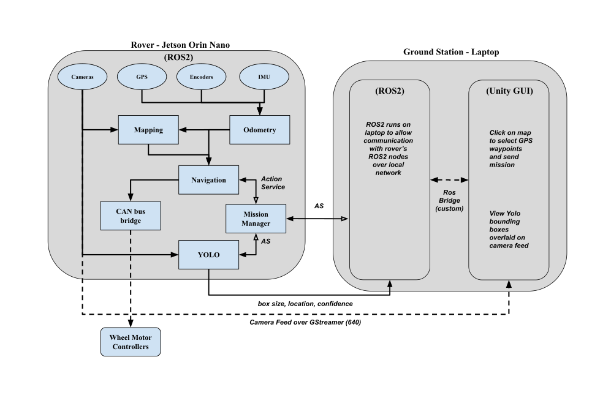

# Oregon State University Mars Rover Team 2023-2024

## Table of Contents
- [Groundstation Setup](#groundstation-setup)
- [Rover Setup](#rover-setup)
  - [Software Dependencies](#software-dependencies)
  - [ROS2 Jazzy](#ros2-jazzy)
  - [MoveIt2](#moveit2)
  - [Intel RealSense](#intel-realsense)
  - [GStreamer](#gstreamer)
- [Building the Project](#building-the-project)
- [Miscellaneous Notes](#miscellaneous-notes-and-stuff)

---

## Architecture Overview


## Groundstation Setup

### Getting Started With Groundstation Code

This repo does not contain groundstation code. To view groundstation code and setup, see the [Rover-Unity repository](https://github.com/OSURoboticsClub/Rover-Unity).

---

## Rover Setup

### Getting Started With Rover Code

We integrate several software environments to help manage our rover. These include:

| Software | Purpose | Link |
|---|---|---|
| ROS2 Jazzy | Middleware & communications | [docs.ros.org](https://docs.ros.org/en/jazzy/index.html) |
| MoveIt2 | IK & path planning | [moveit.picknik.ai](https://moveit.picknik.ai/main/index.html) |
| Intel RealSense SDK | Depth cameras & pointcloud | [github.com/IntelRealSense](https://github.com/IntelRealSense/librealsense) |
| GStreamer | Camera streaming & encoding | [gstreamer.freedesktop.org](https://gstreamer.freedesktop.org/) |

---

### Software Dependencies

#### ROS2 Jazzy

[ROS2 Jazzy](https://docs.ros.org/en/jazzy/index.html) is our middleware communications manager between subsystems on the rover and between the rover and groundstation. ROS2 Jazzy is the current LTS release and targets **Ubuntu 24.04 (Noble)**.

**Installation:**

Follow the official installation guide for your platform:
- [ROS2 Jazzy — Ubuntu (Debian packages)](https://docs.ros.org/en/jazzy/Installation/Ubuntu-Install-Debs.html) *(recommended)*
- [ROS2 Jazzy — Other platforms](https://docs.ros.org/en/jazzy/Installation.html)

Quick install summary for Ubuntu 24.04:

```bash
# Set locale
sudo apt update && sudo apt install locales
sudo locale-gen en_US en_US.UTF-8
sudo update-locale LC_ALL=en_US.UTF-8 LANG=en_US.UTF-8

# Add ROS2 apt repository
sudo apt install software-properties-common
sudo add-apt-repository universe
sudo apt update && sudo apt install curl -y
export ROS_APT_SOURCE_VERSION=$(curl -s https://api.github.com/repos/ros-infrastructure/ros-apt-source/releases/latest | grep -F "tag_name" | awk -F'"' '{print $4}')
curl -L -o /tmp/ros2-apt-source.deb "https://github.com/ros-infrastructure/ros-apt-source/releases/download/${ROS_APT_SOURCE_VERSION}/ros2-apt-source_${ROS_APT_SOURCE_VERSION}.$(. /etc/os-release && echo ${UBUNTU_CODENAME:-${VERSION_CODENAME}})_all.deb"
sudo dpkg -i /tmp/ros2-apt-source.deb
# Install ROS2 Jazzy (desktop-full recommended)
sudo apt update && sudo apt upgrade
sudo apt install ros-jazzy-desktop

# Source the environment (add to ~/.bashrc for persistence)
source /opt/ros/jazzy/setup.bash
```
##### Ros2 package installs
```bash
sudo apt install ros-jazzy-ros2-control ros-jazzy-ros2-controllers \
  ros-jazzy-rmw-zenoh-cpp ros-jazzy-tf-transformations
```

---

#### MoveIt2

[MoveIt2](https://moveit.picknik.ai/main/index.html) operates on top of ROS2 and serves as our IK and path planning solver for our 6-DOF arm. It handles both planning and execution of arm movements.

**Installation:**

MoveIt2 can be installed via apt after ROS2 Jazzy is set up:

```bash
sudo apt install ros-jazzy-moveit
sudo apt install ros-jazzy-moveit-servo
```

For a full setup guide including tutorials, see the [MoveIt2 Getting Started docs](https://moveit.picknik.ai/main/doc/tutorials/getting_started/getting_started.html).

---

#### Intel RealSense

The [Intel RealSense SDK (librealsense)](https://github.com/IntelRealSense/librealsense) provides libraries for interacting with Intel RealSense depth cameras. We use these to perform pointcloud construction and obstacle avoidance on the rover. An additional RealSense camera is mounted on the gripper for arm collision avoidance and planning.

**Installation:**

Follow Intel's official guide: [Linux Installation — librealsense](https://github.com/IntelRealSense/librealsense/blob/master/doc/distribution_linux.md)

```bash
# Register the Intel RealSense repository
sudo mkdir -p /etc/apt/keyrings
curl -sSf https://librealsense.intel.com/Debian/librealsense.pgp \
  | sudo tee /etc/apt/keyrings/librealsense.pgp > /dev/null

echo "deb [signed-by=/etc/apt/keyrings/librealsense.pgp] \
  https://librealsense.intel.com/Debian/apt-repo $(lsb_release -cs) main" \
  | sudo tee /etc/apt/sources.list.d/librealsense.list

sudo apt update && sudo apt install librealsense2-dkms librealsense2-utils librealsense2-dev
```

For the ROS2 RealSense wrapper, also install:

```bash
sudo apt install ros-jazzy-realsense2-camera ros-jazzy-realsense2-description
```

---

#### GStreamer

[GStreamer](https://gstreamer.freedesktop.org/) is our multimedia pipeline framework, used for camera streaming and video encoding. This project uses **NVENC H.265 hardware acceleration** powered by Nvidia Jetson hardware.

**Installation:**

```bash
# Core GStreamer runtime and plugins
sudo apt update
sudo apt install \
  gstreamer1.0-tools \
  gstreamer1.0-plugins-base \
  gstreamer1.0-plugins-good \
  gstreamer1.0-plugins-bad \
  gstreamer1.0-plugins-ugly \
  gstreamer1.0-libav \
  libgstreamer1.0-dev \
  libgstreamer-plugins-base1.0-dev

# For Jetson / NVENC hardware-accelerated encoding
sudo apt install gstreamer1.0-plugins-bad gstreamer1.0-gl
```

> **Note:** NVENC H.265 (`nvh265enc`) requires an **Nvidia Jetson** device with the appropriate Jetpack SDK and GStreamer Nvidia plugins installed. If you are running on non-Jetson hardware, replace `nvh265enc` with the software encoder `x265enc` in the relevant pipeline files. See [Miscellaneous Notes](#miscellaneous-notes-and-stuff) for details.

Useful resources:
- [GStreamer Documentation](https://gstreamer.freedesktop.org/documentation/)
- [Nvidia Jetson GStreamer Guide](https://developer.nvidia.com/embedded/learn/tutorials/first-picture-csi-usb-camera)
- [GStreamer Plugin Reference](https://gstreamer.freedesktop.org/documentation/plugins_doc.html)

---
#### Nav2
[Nav2](https://docs.nav2.org/rolling/) is an open source mobile robot navigation package. It is the most commonly used robot navigation system used in research and is developed and maintained by research experts. The rover uses a Nav2 stack for autonomous naviagation and makes use of rtabmap and robot localization package. Nav2 documentation also have good resources for developing ros2 nodes and plugins. 

```bash
sudo apt update
sudo apt install \
    ros-$ROS_DISTRO-navigation2 \
    ros-$ROS_DISTRO-nav2-bringup \
    ros-$ROS_DISTRO-nav2-minimal-tb\*
sudo apt install ros-jazzy-robot-localization
sudo apt install ros-jazzy-rtabmap-ros

```
---
#### Gazebo
[Gazebo](https://gazebosim.org/docs/latest/ros_installation/) is a simulation framework designed to work with ros2. This simulation software models some physics and provides a better environment compared to pure visualizations found with rviz2. However this is not an advanced simulation like Isaac sim or MuJoCu that are often used for RL, AI, or Visual models. Its integration with ROS2 however does give it an edge for testing full stack operations. 

```bash
sudo apt-get install ros-${ROS_DISTRO}-ros-gz
sudo apt install ros-jazzy-gz-ros2-control
```
---
### Building the Project

Make sure all dependencies above are installed and your ROS2 environment is sourced before building.

```bash
# Source ROS2 Jazzy
source /opt/ros/jazzy/setup.bash

# Navigate to your workspace
cd ~/Rover_2023_2024/software

# Install any missing ROS dependencies. Rover doesn't have rosdep setup.
rosdep update
rosdep install --from-paths src --ignore-src -r -y

# Build the workspace
colcon build --symlink-install

# Source the workspace overlay
source install/setup.bash
```

> **Tip:** Add both `source` lines to your `~/.bashrc` so they apply automatically in every terminal session.

---

## Miscellaneous Notes and Stuff

- **NVENC vs. Software Encoding:** This code uses `nvh265enc` (NVENC H.265 hardware acceleration) for camera pipelines, which requires an Nvidia Jetson. To run on other hardware, replace `nvh265enc` with `x265enc` in the relevant GStreamer pipeline definitions.
- Follow all installation guides closely — ROS2 and its ecosystem have strict environment and dependency requirements.
- Ensure your ROS2 workspace is sourced in every terminal session you use for development or testing.
